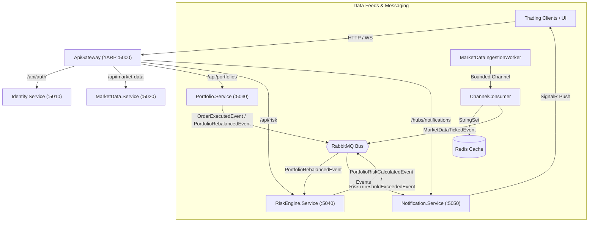

# Algorithmic Portfolio Tracker & Risk Engine

A production-ready **.NET 9** event-driven microservices platform engineered for real-time quantitative portfolio tracking, high-frequency tick ingestion, algorithmic risk computation (VaR, CVaR, Sharpe, Monte Carlo), and instant client notifications.

---

## 1. Architectural Topology

```text
/
├── docker-compose.yml
├── .gitignore
├── Directory.Build.props
├── PortfolioTracker.sln
├── src/
│   ├── BuildingBlocks/
│   │   ├── Shared.Contracts/         # MassTransit events, DTOs, Enums
│   │   └── Shared.Infrastructure/    # OpenTelemetry, MassTransit helpers, Logging, Middleware
│   ├── Services/
│   │   ├── ApiGateway/               # YARP Reverse Proxy
│   │   ├── Identity.Service/         # ASP.NET Identity, JWT Authentication, EF Core
│   │   ├── MarketData.Service/       # BackgroundWorker, Channels (Bounded), Redis cache
│   │   ├── Portfolio.Service/        # CQRS (MediatR), EF Core, Outbox Pattern
│   │   ├── RiskEngine.Service/       # Math.NET Numerics, Compute-heavy consumers, Monte Carlo
│   │   └── Notification.Service/     # ASP.NET Core SignalR + MassTransit Consumers
└── tests/
    └── Shared.Contracts.Tests/       # Contract immutability, serialization & validation tests
```

---

## 2. Microservice Catalog & Port Allocation

| Component | Responsibility | Tech Stack | Internal Port | External Port |
| :--- | :--- | :--- | :--- | :--- |
| **ApiGateway** | Unified ingress, routing, TLS, CORS | YARP Reverse Proxy | 8080 | **5000** |
| **Identity.Service** | User authentication, JWT issuance, identity store | ASP.NET Identity, EF Core | 8080 | **5010** |
| **MarketData.Service** | Live tick generation, channel buffering, Redis caching | Channels, BackgroundService, Redis | 8080 | **5020** |
| **Portfolio.Service** | Portfolio management, trade execution, position tracking | CQRS, MediatR, EF Core, Outbox | 8080 | **5030** |
| **RiskEngine.Service** | Parametric/Historical VaR, CVaR, Sharpe, Monte Carlo | Math.NET Numerics, MassTransit | 8080 | **5040** |
| **Notification.Service**| Real-time WebSocket alerts and price feeds | ASP.NET Core SignalR, MassTransit | 8080 | **5050** |
| **PostgreSQL** | Relational datastore for Identity and Portfolios | Postgres 17 Alpine | 5432 | **5432** |
| **Redis** | In-memory cache for market quotes and tick rates | Redis 7.4 Alpine | 6379 | **6379** |
| **RabbitMQ** | Asynchronous event bus broker | RabbitMQ 3.13 Management | 5672 | **5672 / 15672** |
| **Seq** | Structured log visualization and search | Datalust Seq | 80 | **5341** |

---

## 3. High-Level Event Flow



---

## 4. Key Architectural Patterns Implemented

1. **Clean Architecture & Modular Monorepo**: Decoupled domain contracts and cross-cutting infrastructure blocks (`Shared.Contracts`, `Shared.Infrastructure`).
2. **High-Throughput Concurrency**: Utilizes `System.Threading.Channels` with bounded capacities to prevent thread pool exhaustion and guarantee backpressure control under tick surges.
3. **Transactional Outbox Pattern**: In `Portfolio.Service`, trade executions and rebalances persist the business entity state and outbox messages within a single atomic database transaction, published reliably by a dedicated `OutboxProcessorWorker`.
4. **Quantitative Financial Computation**: Embedded `MathNet.Numerics` algorithms calculating:
   - Parametric Value at Risk (VaR 95%, VaR 99%)
   - Conditional Value at Risk (Expected Shortfall)
   - Annualized Sharpe & Sortino Ratios
   - Stochastically modeled Monte Carlo trajectories across arbitrary time horizons.
5. **Observability-First**: Standardized distributed tracing and metrics via OpenTelemetry and structured logging via Serilog directed to Seq.

---

## 5. Quickstart & Deployment

### Prerequisites
- Docker & Docker Compose
- .NET 9.0 SDK (optional for local non-container execution)

### Launching with Docker Compose
To run all microservices and backing infrastructure:
```bash
docker-compose up --build -d
```

### Accessing Dashboards
- **YARP API Gateway**: [http://localhost:5000](http://localhost:5000)
- **RabbitMQ Management**: [http://localhost:15672](http://localhost:15672) (User: `quant_broker`, Pass: `QuantBrokerPass123!`)
- **Seq Log Server**: [http://localhost:5341](http://localhost:5341)
- **Notification SignalR Hub**: `ws://localhost:5000/hubs/notifications`
